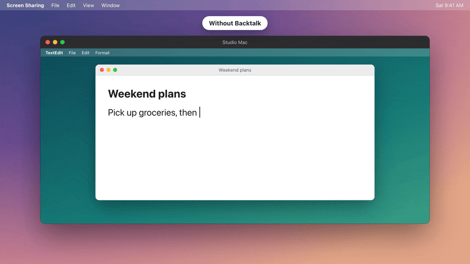

# Backtalk



Dictation apps and clipboard managers don't paste correctly into Apple's Screen Sharing. You dictate a paragraph with Wispr Flow, or pick something from your clipboard manager, and the remote Mac just gets a **"v"**.

These apps paste by putting text on the clipboard and pressing a fake ⌘V. Screen Sharing drops the ⌘ from keystrokes sent by apps, so only the "v" gets through.

Backtalk is a [Hammerspoon](https://www.hammerspoon.org) Spoon that catches that fake ⌘V while Screen Sharing is in front. It sends your clipboard to the remote Mac over SSH and pastes it there. This works for any app that pastes this way. That includes dictation apps like Wispr Flow, Superwhisper, VoiceInk, MacWhisper, Aqua Voice, Spokenly, Handy and Hex, and clipboard managers like Copy'em.

Your own ⌘V presses, and every other app, are left alone.

## How it works

1. An app posts a fake ⌘V while Screen Sharing is frontmost. Real key presses are ignored.
2. Backtalk swallows the keystroke, so the remote Mac never sees the "v".
3. It reads the remote computer's name from the Screen Sharing window title and looks up its SSH host.
4. It runs `pbcopy` on the remote Mac with your clipboard, then presses ⌘V there with `osascript`.

The SSH connection is kept open for 10 minutes, so pastes after the first one are nearly instant.

## Setup

Run these steps on **both** Macs if you want it to work in both directions.

### On the Mac you're controlling *from*

1. Install [Hammerspoon](https://www.hammerspoon.org). Open it and give it Accessibility access when it asks.
2. Install the Spoon:
   ```sh
   git clone https://github.com/mackinleysmith/backtalk.git
   cp -R backtalk/Backtalk.spoon ~/.hammerspoon/Spoons/
   ```
3. Set up an SSH key for the remote Mac, if you don't have one already:
   ```sh
   ssh-keygen -t ed25519      # skip if ~/.ssh/id_ed25519 exists
   ssh-copy-id you@other-mac.local
   ```
   This needs step 1 of the next section to be done first.
4. Add this to `~/.hammerspoon/init.lua`, then reload Hammerspoon's config:
   ```lua
   hs.loadSpoon("Backtalk"):start({
     hosts = {
       -- Remote computer name (as in the Screen Sharing window title) → SSH host
       ["Office Mac"] = "you@office-mac.local",
     },
   })
   ```

The name is whatever Screen Sharing shows as the window title when you're connected. You can also run `scutil --get ComputerName` on the remote Mac.

### On the Mac being controlled

1. Turn on **System Settings → General → Sharing → Remote Login**.
2. Let SSH sessions press keys. Go to **System Settings → Privacy & Security → Accessibility**, click **+**, press ⌘⇧G, and enter:
   ```
   /usr/libexec/sshd-keygen-wrapper
   ```
   This is the macOS process that runs SSH sessions. Without this, the paste fails with "not allowed to send keystrokes". Read [Security](#security) before doing this.

### Check your setup

Run this from the Mac you're controlling *from*:

```sh
./doctor.sh you@office-mac.local
```

It checks each step above and tells you what's missing.

## Push-to-talk dictation apps

Screen Sharing also forwards your dictation hotkey. If the remote Mac runs the same dictation app, holding the key starts it on both Macs. The remote copy then listens to its own microphone and can get stuck.

Backtalk handles this for you. While you're screen-sharing a Mac, it quits any of these apps that are running there:

> Wispr Flow, superwhisper, VoiceInk, MacWhisper, Aqua Voice, Spokenly, Handy, Hex

When the session ends, it reopens only the apps it quit. Sessions can end in several ways: closing the window, the remote Mac sleeping, a dropped connection, or someone pressing Escape on the remote Mac. Reopened apps start in the background, and Backtalk closes their main window so they don't pop up. If the remote Mac can't be reached at that moment, Backtalk keeps retrying. It remembers what it quit in `~/.backtalk-paused` on the remote Mac, so this also works if Hammerspoon reloads.

To change the list, set `pauseApps`. Use each app's name as it appears in `/Applications`, or `{}` to turn this off. An entry can also be a table that changes how the app is reopened:

```lua
hs.loadSpoon("Backtalk"):start({
  hosts = { ["Office Mac"] = "you@office-mac.local" },
  pauseApps = {
    "Wispr Flow",
    { "Some App", openArgs = { "-g", "-j" }, closeWindows = false },
  },
})
```

`openArgs` are passed to `open`. The default is `{ "-g" }`, which opens the app in the background. `closeWindows = false` leaves the app's windows open after it relaunches.

## Security

Adding `sshd-keygen-wrapper` to Accessibility means **anyone who can SSH into that Mac as you can control its keyboard and mouse**. That's what lets Backtalk press ⌘V. Remote Login already gives SSH users full shell access to your account, so this adds little to what an attacker with your SSH key could do. Even so, only enable it on Macs where SSH is limited to your own keys.

Your clipboard is sent over SSH only, so it's encrypted in transit. Backtalk doesn't log or store what you paste.

## Limitations

- **Text only.** If the clipboard holds an image or a file, the paste is swallowed and nothing is pasted.
- **Apple Screen Sharing only.** Other remote desktop apps aren't detected.
- **Every fake ⌘V into Screen Sharing goes to the remote Mac.** That's the point, but it includes apps you might not expect, such as text expanders.

## Demo

The animation above is made in `demo/scene.html` and rendered with `cd demo && npm install && npm run render`. That needs `ffmpeg` and `gifski` installed (`brew install ffmpeg gifski`).

## License

MIT
